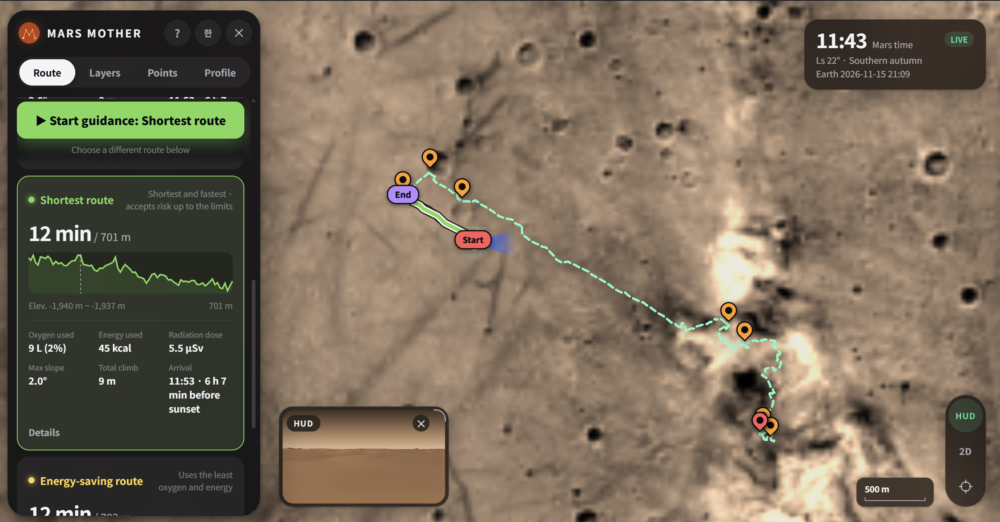
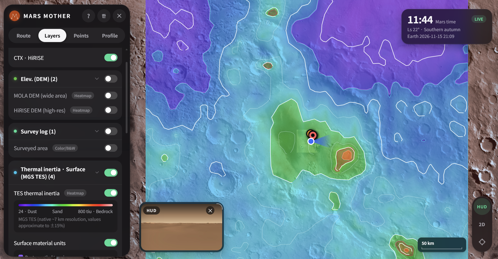
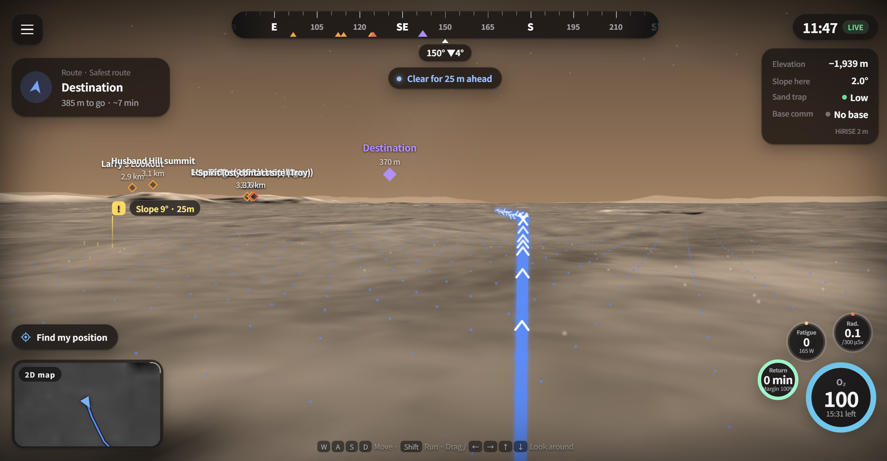
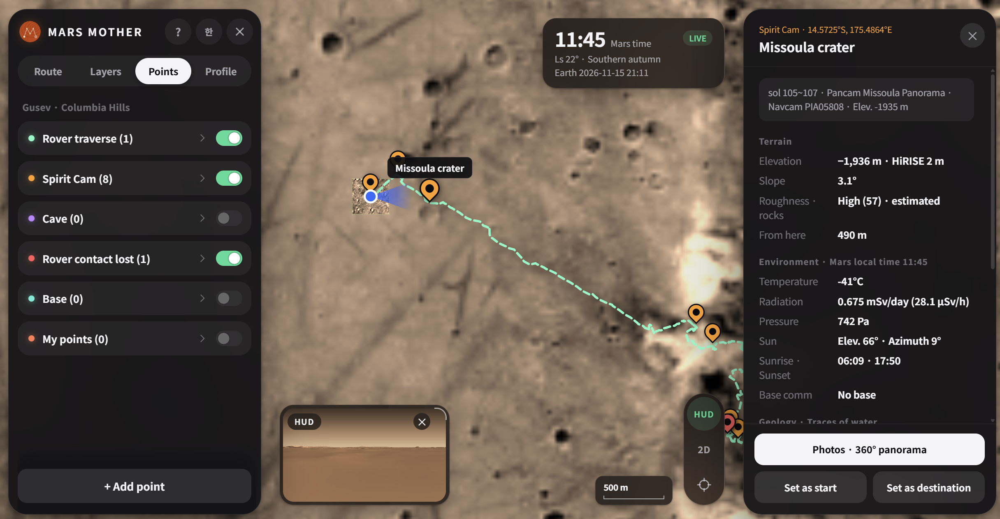
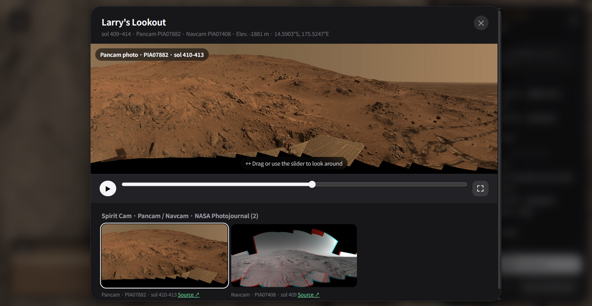
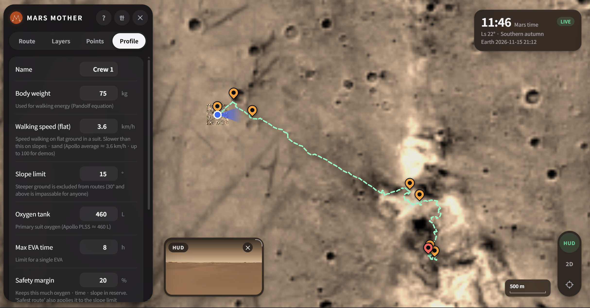
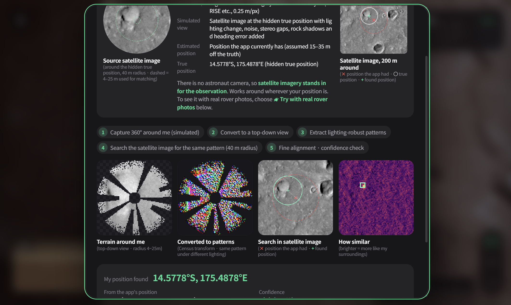

# marsmother

## 2026 NASA Space Apps Challenge - Interplanetary Survival Guide: Martian Map 
This project was developed as a submission to the 2026 NASA Space Apps Challenge. Details about the challenge topic can be found at the link below. 
https://www.spaceappschallenge.org/2026/challenges/interplanetary-survival-guide-martian-map/
 
## Website
https~~~~

## Route
Finds walkable routes between a start point, up to three waypoints and a destination over real HiRISE terrain data (D* Lite), and shows the time, oxygen, energy and radiation each route would cost.

## Layers
Turns science overlays on and off over the map, including elevation, thermal inertia, signs of past water and hazards such as sand traps, radiation, return limits and communication coverage.

## HUD
Switches to a first-person AR view on real 3D terrain, with a hazard scan, a compass, route guidance and live suit vitals (oxygen, coolant, power, fatigue, radiation).

## Points
Adds your own points on the map, such as a base, a cave or a custom marker, and shows photos from the Spirit rover's cameras at mission sites. Pin any point on the map to see a predicted 360° panorama, generated from elevation data, of what the view would look like from that spot.

## Profile
Edits each crew member's personal limits and equipment, such as body weight, walking speed, slope limit, oxygen tank, EVA time and radiation limit. Routes, the HUD and the return-limit layer all update from these values.

## Localization
Finds your exact position without GPS by matching the terrain around you against orbital imagery, following the Censible method from NASA JPL.

## Data
assets/ 
ㄴlayers/ 
	ㄴhirise-relief.jpg # MRO HiRISE, DEM Columbia Hills in Mars Trek  
	ㄴmola-relief.jpg # MGS MOLA and Mars Express HRSC, DEM in Mars Trek  
	ㄴti-overlay.png # MGS TES, Global Thermal Inertia in Mars Tre k 
ㄴlocalize/ 
	ㄴspirit-orbit.png # https://pds.nasa.gov  
	ㄴspirit-sol036-obs.png # https://pds.nasa.gov  
	ㄴspirit-sol036-view.png # https://pds.nasa.gov  
ㄴmaps/ # MRO HiRISE, Mosaic Columbia Hills in Mars Trek  
ㄴrover/ # https://science.nasa.gov/photojournal/  
ㄴsites/ # https://pds.nasa.gov  
ㄴterrain/  
	ㄴhud-tiles/ # MRO HiRISE, DEM Columbia Hills in Mars Trek  
	ㄴgusev-30km-height.png # MRO HiRISE, DEM Columbia Hills in Mars Trek  
	ㄴhud-near-height.png # MRO HiRISE, DEM Columbia Hills in Mars Trek  
	ㄴhud-near-surface.jpg # MRO HiRISE, Mosaic Columbia Hills in Mars Trek  
	ㄴmola-400km-height.png # MGS MOLA and Mars Express HRSC, DEM in Mars Trek  